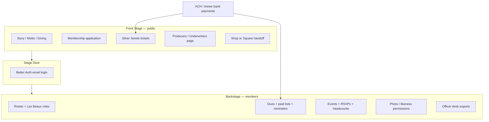

# Les Belles Femmes — Krewe Portal Build Plan

**Repo:** [MissTully/krewe-les-belles-femmes-website](https://github.com/MissTully/krewe-les-belles-femmes-website)  
**Live preview:** https://krewe-les-belles-femmes-website.vercel.app  
**Product:** Krewe & Kin digital home for Les Belles Femmes (Tampa Bay)  
**Reference krewe (as-built):** [MissTully/Shamrock](https://github.com/MissTully/Shamrock) · https://www.kreweofshamrock.com  
**Proposal source:** *The Digital Home of Les Belles Femmes — A 25th Anniversary Proposal & Service Agreement* (Krewe & Kin), attached deck 2026-09-09  
**Status:** plan locked to proposal Acts + current repo inventory · **2026-09-09**

---

## 1. One-sentence goal

Ship a **Front Stage** public site that matches LBF’s Moulin Rouge heritage, then unlock a secure **Stage Door / Backstage** member hub (roster, dues, RSVPs, photo permissions, Soirée ticketing) so the krewe stops running on Facebook + Square + Excel + email + Venmo.

---

## 2. What already exists in this repo (do not rebuild)

This is **not** a greenfield static site. LBF already has a Vite + TanStack Start app with cabaret branding.

| Area | Status today | Notes |
|---|---|---|
| Public home / story / sisterhood / giving / events | **Strong** | Routes under `src/routes/*`, art in `public/art`, copy in `src/lib/content.ts` |
| Silver Soirée marketing page | **Partial** | `src/routes/soiree.tsx` + form component; native paid ticketing not done |
| Shop | **Partial** | Client cart + Square outbound (`links.shop`); not krewe-ledger ACH yet |
| Membership / apply | **Partial** | Public apply UX; not wired to officer approval queue |
| Comp cards / Circle | **Early** | `member_profiles` migration + localStorage fallback; edit-code model, not full auth roster |
| Auth | **Scaffold** | Better Auth schema in `migrations/auth/0001_auth.sql`; Stage Door not productized |
| Database | **Neon / PGLite** | Migrations apply on build via `scripts/migrate.mjs` |

**Stack decision (locked for LBF):** stay on **this** app stack (Vite, TanStack Router/Start, Better Auth, Neon). Do **not** clone Shamrock’s static HTML + Supabase project file-for-file. Shamrock is the **capability and SQL pattern reference**. LBF ports features into this codebase as ordered migrations + server actions.

---

## 3. Product architecture (from the proposal)

**Hub and spoke modules (proposal Act I target state):** Dues · Events · The Roster · Communications.

**Risks the portal must retire (proposal):** personal Venmo/Zelle 1099-K exposure · Excel single-point roster · photo yes-texts as “permission.”

---

## 4. Two-opening timeline (proposal)

Protecting the Soirée is first priority.

### Phase 1 — Public Opening (target: mid-October 2026)

- Public site polished and on the real domain
- Silver Soirée tickets live **natively** (guest list, no Eventbrite)
- Underwriters / Producers page live to fund the $3,950 build
- Application form routes to the membership officer (not a dead inbox)

### Phase 2 — Backstage Opening (target: January 2027, pre-Gasparilla)

- Stage Door unlocks: member login
- Dues reminders + paid vs unpaid export for Treasurer
- Les Beaux + Belle roster (member-managed profiles)
- Event RSVPs / replies with live headcounts
- Photo permission stored on the permanent profile

---

## 5. Capability map: Shamrock → LBF

Use Shamrock as the working playbook. Port **behavior**, rewrite **implementation** for Neon + Better Auth + React.

| Krewe need | Shamrock reference | LBF build target |
|---|---|---|
| Public story + recruitment | Public HTML pages + join flow | Keep/enhance existing routes; wire apply → `applications` table + officer email |
| Member auth | Supabase Auth | Better Auth (`migrations/auth`) + Stage Door UI (`/stage-door` or `/members/login`) |
| Roster / directory | `v_member_profiles`, rich profiles, titles | Evolve `member_profiles` → auth-linked profiles, roles: Belle / Les Beaux / Friend / Officer |
| Role approvals | `kos_role_approvals_onboarding.sql` | `applications` + officer approve/deny → invite user |
| Events + RSVP | `kos_public_events_and_rsvp.sql` | `events`, `event_rsvps`, officer headcount view |
| Dues / payments ledger | `kos_payments.sql` + Zeffy webhook | Prefer **ACH into krewe accounts** (proposal ROI). Ledger table + webhook/Edge or server route. Zeffy or Stripe ACH TBD in Phase 1 spike |
| Shop | Shop Studio + Zeffy | Short term: keep Square link. Mid term: optional portal products |
| Photo / media consent | Hub likeness gate | `photo_permission` + `photo_permission_at` on profile; gate public galleries |
| Officer desk | Reports, Event Studio, exports | `/backstage` officer routes: paid list CSV, RSVP counts, applications |
| Raffles / Craic Cup | Shamrock-specific | **Out of LBF v1** unless board asks |
| Learn / heritage modules | `learn.html` | Optional later; not on critical path |
| Email forwarding | ImprovMX role aliases | Set `membership@` / `treasurer@` / `digital@` on LBF domain when owned |

---

## 6. How we capture architecture, SQL, and “the kit”

This is the Krewe & Kin capture pattern for **this** krewe and future krewes.

### 6.1 In-repo sources of truth

| Artifact | Path | Purpose |
|---|---|---|
| This build plan | `BUILD_PLAN.md` | Phases, scope, decisions |
| Brand + copy config | `src/lib/content.ts` (+ future `krewe.config.ts`) | Name, motto, links, nav, charities |
| Ordered SQL | `migrations/*.sql` | Schema that creates an empty krewe DB |
| Auth schema | `migrations/auth/0001_auth.sql` | Better Auth tables (copy up when Stage Door turns on) |
| Server data access | `src/lib/app-data/*`, `profile-actions.ts` | No business rules only in the browser |
| Shamrock SQL pack (reference) | Shamrock `sql/kos_*.sql` | Patterns to translate, not paste blindly |
| Shamrock architecture | Shamrock `SOFTWARE_ARCHITECTURE.md` | Hosting / cost / module narrative |

### 6.2 Migration pack to add (LBF Neon)

Create these as new ordered files (names illustrative; adjust numbering to match apply order):

1. `0003_applications.sql` — public membership inquiries  
2. `0004_member_profiles_v2.sql` — link profiles to `user.id`, roles, photo permission, dues status fields  
3. `0005_events_and_rsvps.sql` — events, RSVPs, capacity, guest counts  
4. `0006_payments_ledger.sql` — dues + ticket payments, provider refs, paid/unpaid views  
5. `0007_soiree_tickets.sql` — ticket SKUs, orders, guest list for Nov 14, 2026 Carrollwood CC  
6. `0008_producers.sql` — underwriters / Friends of the Anniversary listings  
7. `0009_officer_grants.sql` — which users are officers/treasurer/membership

Each file: tables + indexes + comments. Prefer **server-enforced** auth (Better Auth session) over browser keys. If RLS is added later on Neon, document policies beside the tables.

### 6.3 Export / handoff checklist (for the next krewe)

When LBF Backstage is stable, extract a **Krewe Kit** folder (can live in a future `krewe-and-kin-kit` repo):

- `ARCHITECTURE.md` (generic hub-and-spoke)  
- `migrations/` clean install  
- `krewe.config.example.ts` (brand tokens, domain, payment IDs, feature flags)  
- `LAUNCH.md` (DNS, Vercel, Neon, Auth email templates, ACH provider, first officer accounts)  
- Screenshot pack of Front Stage + Stage Door  

Until then, **this plan + Shamrock’s `sql/` + this repo’s migrations** are the capture.

---

## 7. Phase workstreams (actionable)

### P0 — Foundations (now → early October)

- [ ] Domain + DNS → Vercel production (replace preview URL)  
- [ ] Confirm Neon `DATABASE_URL` on Vercel; migrations run on every production build  
- [ ] Turn on Better Auth email/password for officers first (Stage Door soft)  
- [ ] Payment spike: **ACH into krewe bank** options vs Zeffy (match proposal ROI of ACH vs Square)  
- [ ] Officer contacts in config: membership, treasurer, digital (replace personal-only routing where possible)

### P1 — Public Opening (Soirée-critical)

- [ ] Native Silver Soirée ticketing + guest list (`soiree` order flow)  
- [ ] Producers / Underwriters page (theater-program listing, no ads)  
- [ ] Application → DB + email to membership officer  
- [ ] Giving page names Spring of Tampa Bay + Pediatric Cancer Foundation clearly  
- [ ] Brand pass against proposal art (wine / gold / parchment / Stage Door metaphor)  
- [ ] Soft launch checklist: mobile, OG image, favicon, 404, form spam protection

### P2 — Backstage Opening (pre-Gasparilla 2027)

- [ ] Member self-serve roster (retire Excel as source of truth)  
- [ ] Les Beaux role distinct in directory + permissions  
- [ ] Dues ledger + automated gentle reminders + Treasurer CSV  
- [ ] Events RSVP + officer headcounts  
- [ ] Photo permission on profile; gate any member photo publishing  
- [ ] Officer desk: applications, paid list, RSVPs, export

### P3 — Polish / optional

- [ ] Communications center (announcements)  
- [ ] In-portal shop if Square fees remain painful  
- [ ] Import legacy roster CSV once  
- [ ] Member guide PDF (Shamrock pattern)

---

## 8. Silver Soirée facts (lock into product + content)

- **Event:** Silver Soirée  
- **Date:** November 14, 2026  
- **Place:** Carrollwood Country Club  
- **Rule:** Portal handles ticketing and guest lists natively (proposal: Eventbrite cheapens the brand and takes high fees)  
- **Charities to feature:** The Spring of Tampa Bay · Pediatric Cancer Foundation  

---

## 9. Funding equation (context, not engineering)

Proposal funding for the custom build (~$3,950) via anniversary underwriting, with board out-of-pocket $0. Ongoing hosting/maintenance (~$125/mo in the proposal) intended to be offset by ACH fee savings vs Square Online. Engineering should optimize for **krewe-owned ACH settlement** and clean ledgers so that story stays true.

---

## 10. Explicit non-goals for v1

- Multi-tenant single database for all krewes (future Krewe & Kin platform)  
- Shamrock Craic Cup / raffles parity  
- Replacing Facebook social chatter (portal complements; does not replace community)  
- Rewriting LBF into static HTML to match Shamrock’s file layout  

---

## 11. Definition of done

**Public Opening done when:** a guest can buy a Soirée ticket on-brand, land on the guest list, and an underwriter can be listed on the Producers page without touching Eventbrite or a spreadsheet.

**Backstage Opening done when:** a Belle can log in, update her card, see dues status, RSVP to a krewe event, and record photo permission; Treasurer can export paid vs unpaid without opening Excel or Venmo.

---

## 12. Immediate next commits (suggested order)

1. Keep this `BUILD_PLAN.md` current as decisions land  
2. Add `docs/CAPTURE.md` short pointer (Shamrock SQL list + LBF migration map) — optional sibling doc  
3. `0003_applications.sql` + wire `ApplyForm`  
4. Payment provider spike doc → choose ACH path  
5. Soirée ticket schema + checkout UI  

---

*Maintained by Krewe & Kin / Encountive for Les Belles Femmes. Update this file when a phase ships or a stack decision changes.*
